# Crystery

  

**中文** · [English](#english)

Crystery 是一个 Windows 桌面软件，用来查看晶体和分子结构、画出可以发表的结构图，并模拟粉末衍射（PXRD）图谱、分析孔道。下载即可使用，不需要另外安装 Python、PyMOL 或其他程序。

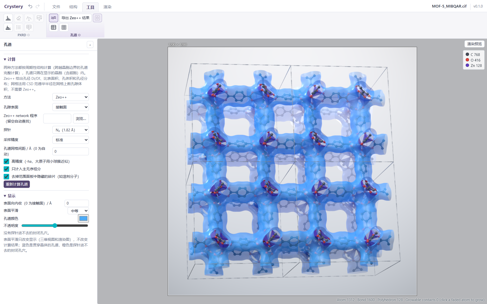

<sub>Crystery 的窗口：用 Zeo++ 算出 MOF-5 的孔道（左侧是孔道的计算和显示设置），渲染框中是 Mitsuba 的渲染预览。</sub>

> ⭐ **如果 Crystery 对你有帮助，请给这个仓库点一个 Star；用它作图或计算的论文，请在支持信息（SI）中引用一下（格式见[下文](#支持-crystery)）。** 这是对开发最大的支持。

[下载](#下载) · [快速上手](#快速上手) · [操作手册](docs/manual.md) · [示例图库](#示例图库) · [功能](#功能) · [常见问题](#常见问题) · [支持 Crystery](#支持-crystery) · [许可](#许可) · [反馈](#反馈)

## 下载

在 [Releases](https://github.com/luylin5/Crystery-release/releases) 页面下载最新版本：

| 文件 | 说明 |
|---|---|
| `Crystery-<版本>-setup.exe` | **安装包（推荐）**：双击安装，可以选择安装位置，创建桌面和开始菜单快捷方式 |
| `Crystery-<版本>-portable.exe` | 便携版：不用安装，双击即可运行 |

- 系统要求：Windows 10 / 11，64 位。Mitsuba 渲染有 NVIDIA 显卡时更快，没有显卡也能用 CPU 渲染。
- 安装版的设置保存在用户的 AppData 中，图库在“文档\Crystery 图库”，升级或卸载都不会删除；便携版保存在程序旁边的 `Crystery-data` 文件夹中，整个文件夹可以直接拷走。
- Windows 可能提示“无法识别的应用”（安装包没有代码签名）：点“更多信息” › “仍要运行”。
- 软件内 **文件 › 帮助 › 检查更新** 可以查看是否有新版本。

## 快速上手

1. **打开结构**：把文件拖进窗口，或 **文件 › 打开**（Ctrl+O）。也可以在资源管理器中用“打开方式”选 Crystery。
2. **调整画面**：右键拖动旋转，滚轮缩放，中键或 Ctrl+右键拖动平移；左键单击选择原子，双击选中整个分子。模型、颜色、多面体、超胞等在 **结构** 功能区，参数显示在左侧栏。
3. **渲染出图**：在 **渲染** 功能区选渲染器（PyMOL 或 Mitsuba），设好图片尺寸和 DPI，点 **渲染预览** 看效果，满意后 **导出图片**。画面中间的渲染框就是导出的范围。
4. **保存**：**保存到图库**（Ctrl+S）把结构、设置和视角一起存下，以后在图库（Ctrl+G）中点缩略图就能按原样打开；调好的画法可以存成 **预设风格**，用到别的结构上。

### 演示：MOF-5 的孔道计算与渲染

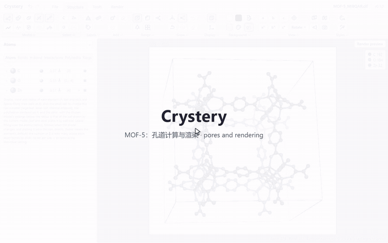

打开 MOF-5 → 配位多面体和 2×2×1 超胞 → **工具 › 孔道** 用 Zeo++ 计算孔道（N₂ 探针）→ 查看结果表 → **渲染 › Mitsuba** 渲染预览。计算和渲染的等待时间做了加速。[下载高清 MP4](examples/demo/mof-5-demo.mp4)

界面默认是英文，**文件 › 选项 › 语言** 切换为中文。每个功能的详细说明见 **[操作手册](docs/manual.md)**（软件中按 F1 打开同一份手册）。

## 示例图库

下面的图都是用 Crystery 画的，孔道由软件内的 Zeo++ 计算并画进渲染图。

**MOF 与孔道**

<table>
<tr>
<td width="50%">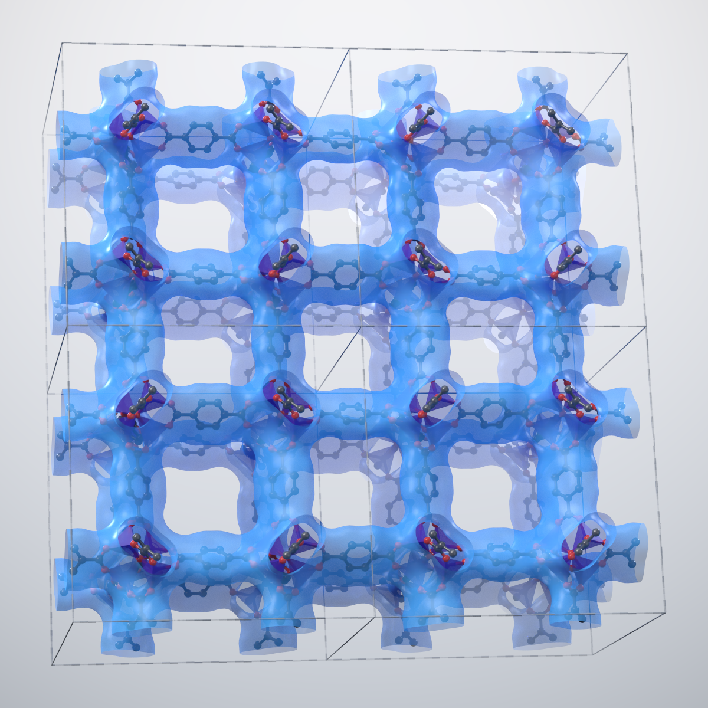</td>
<td width="50%">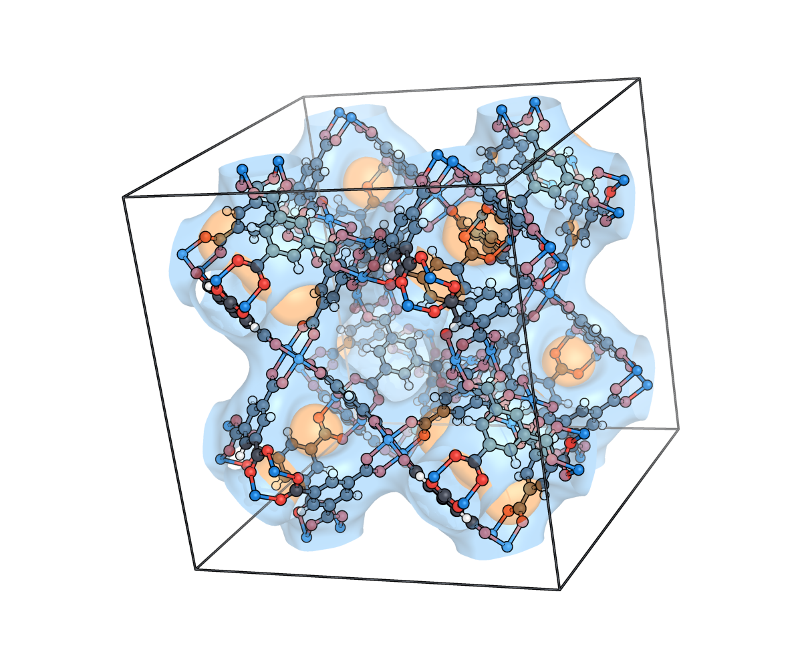</td>
</tr>
<tr>
<td>MOF-5：N₂ 探针的孔道接触面，ZnO₄ 多面体（Mitsuba）</td>
<td>HKUST-1：贯通的孔道（蓝）和 N₂ 进不去的封闭孔穴（橙）（PyMOL）</td>
</tr>
<tr>
<td colspan="2">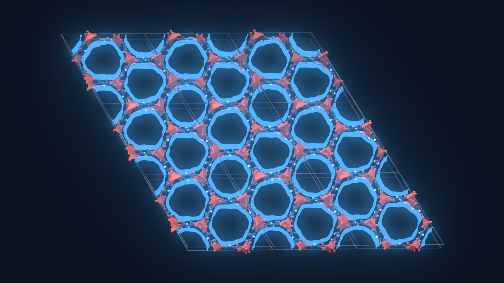</td>
</tr>
<tr>
<td colspan="2">Co-MOF-74：沿 c 轴看到的一维六边形孔道，深色背景上孔道发光（Mitsuba）</td>
</tr>
</table>

**笼子与客体**

<table>
<tr>
<td width="50%">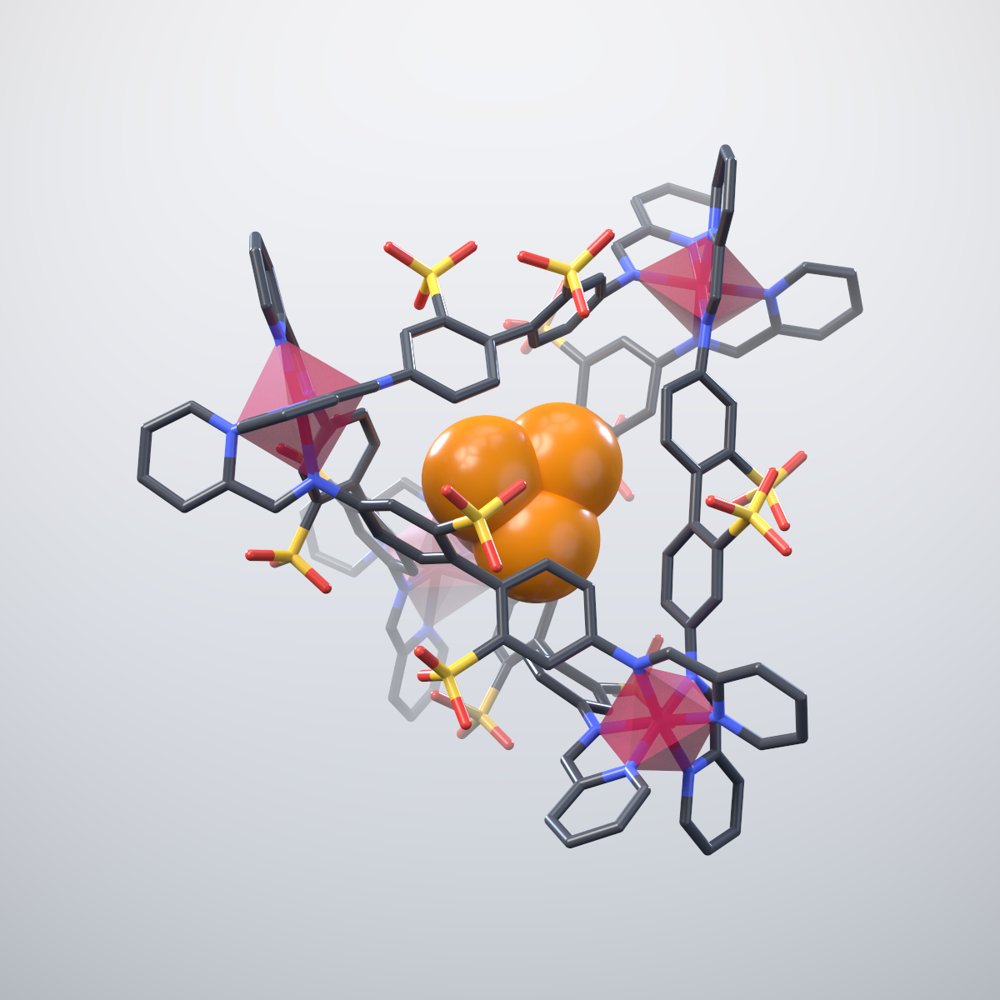</td>
<td width="50%">Fe₄L₆ 四面体笼中包着的白磷分子 P₄。笼子画成棍状和 FeN₆ 配位多面体，客体单独设为空间填充，用 Mitsuba 路径追踪渲染。</td>
</tr>
</table>

**渲染风格**：同一个笼子、同一个视角

<table>
<tr>
<td>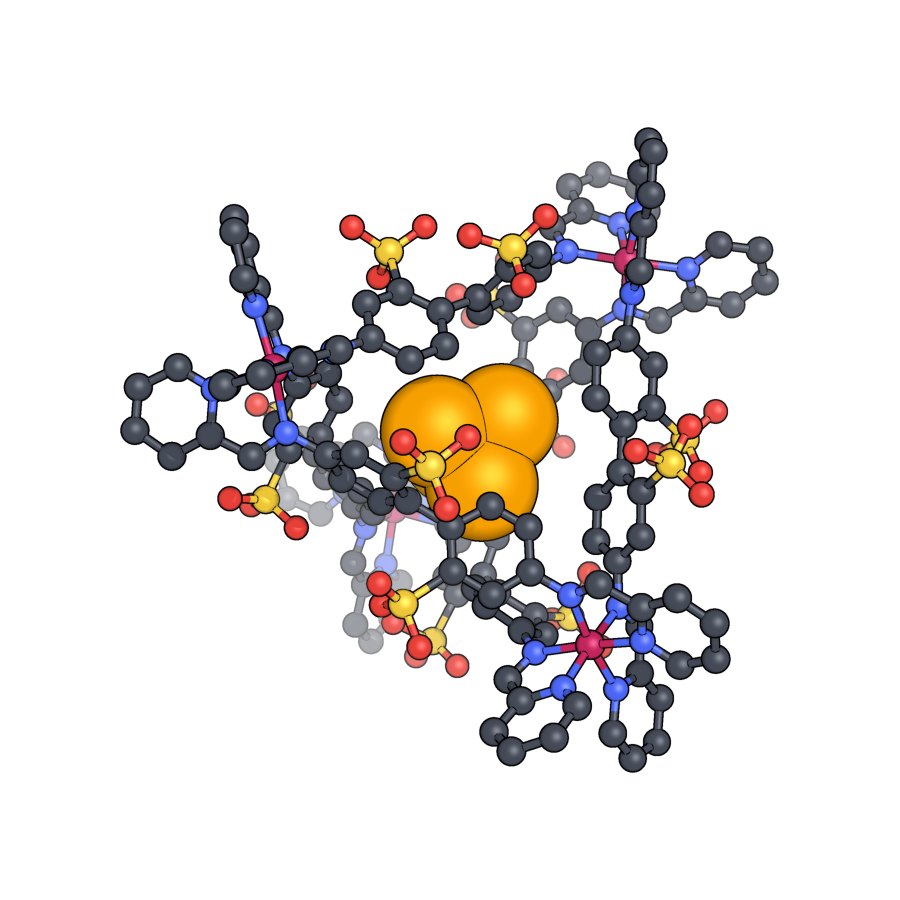</td>
<td>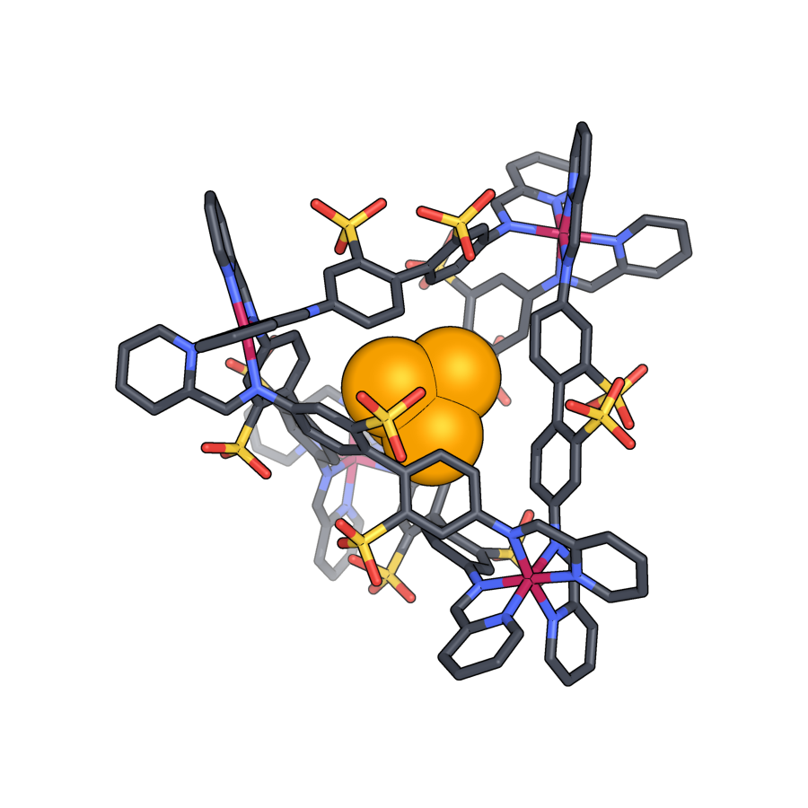</td>
<td>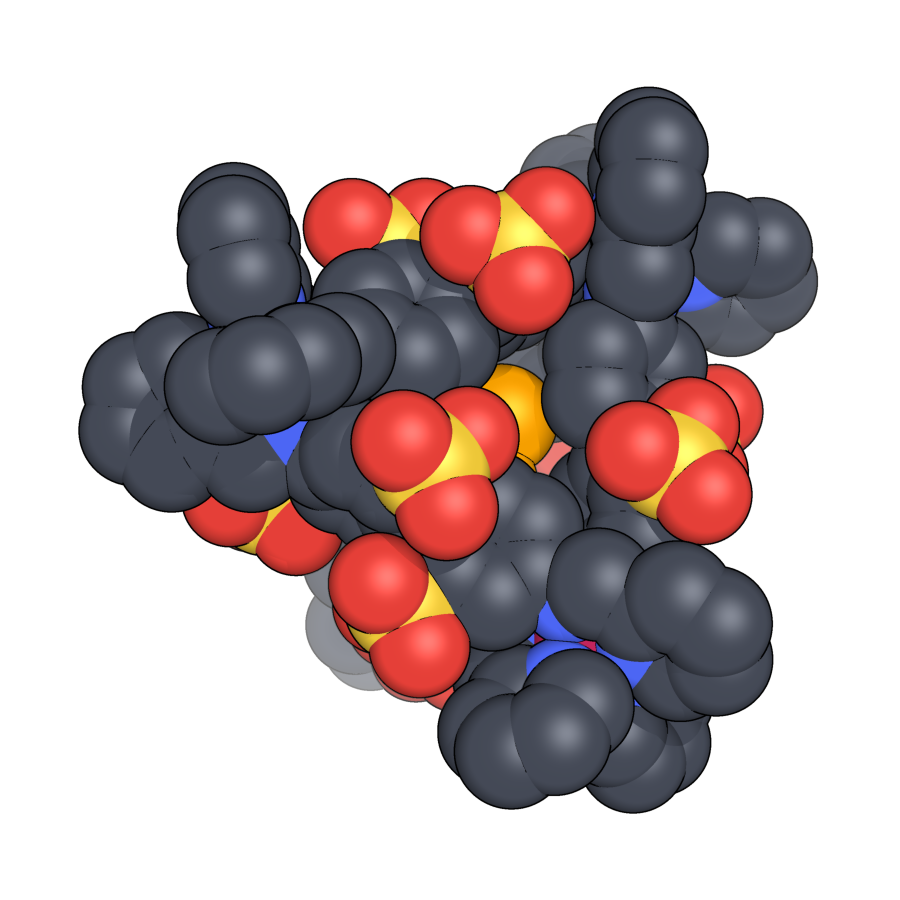</td>
<td>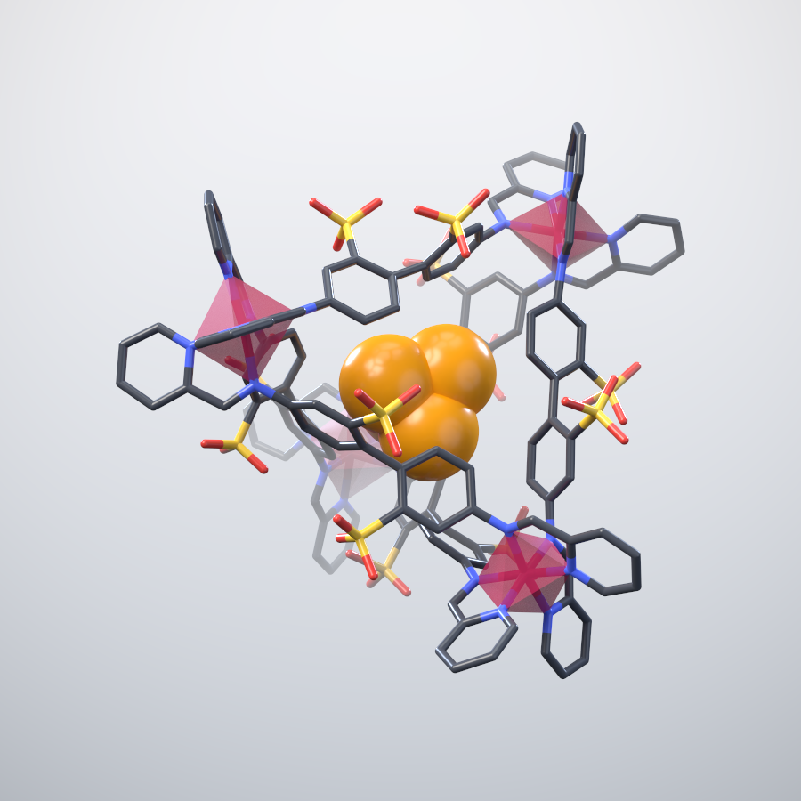</td>
</tr>
<tr>
<td>PyMOL · 球棍</td><td>PyMOL · 棍状加轮廓</td><td>PyMOL · 空间填充</td><td>Mitsuba · 光泽塑料</td>
</tr>
<tr>
<td>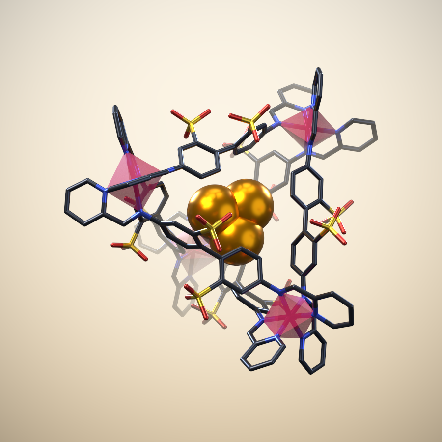</td>
<td>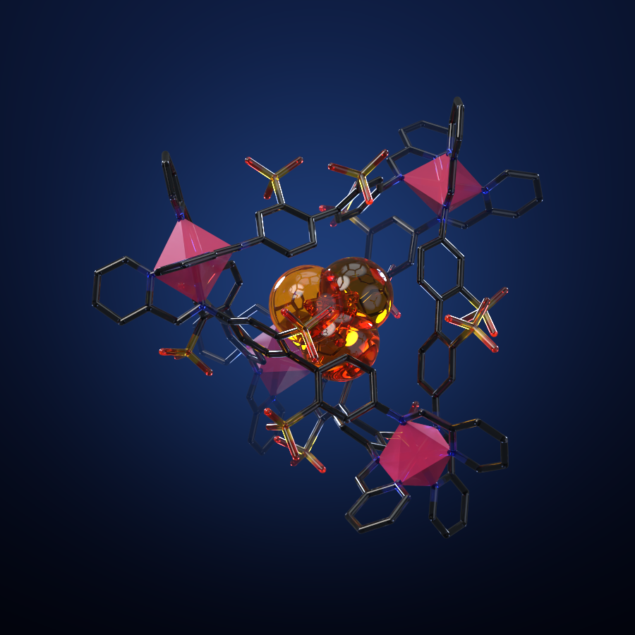</td>
<td>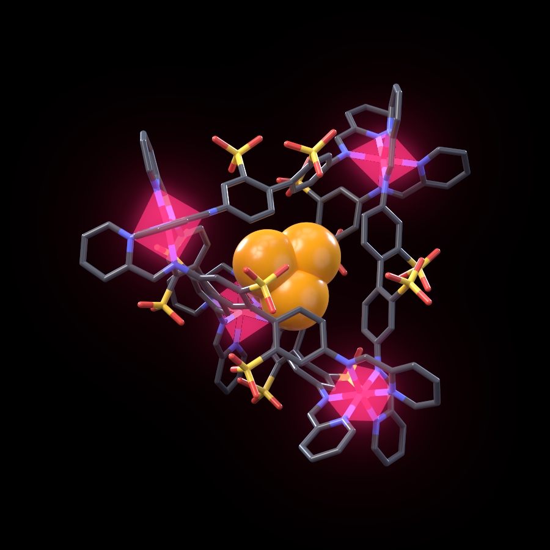</td>
<td>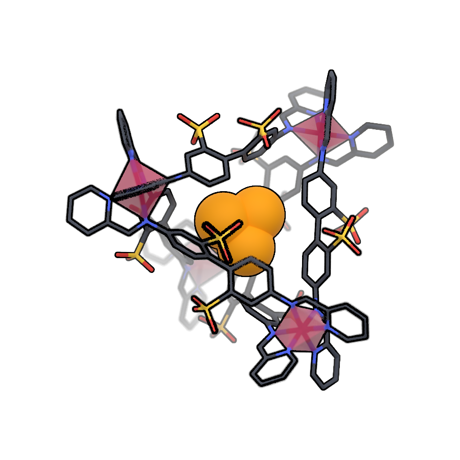</td>
</tr>
<tr>
<td>Mitsuba · 金属</td><td>Mitsuba · 玻璃</td><td>Mitsuba · 发光</td><td>Mitsuba · 哑光、轮廓、景深</td>
</tr>
</table>

结构来自剑桥结构数据库（CSD）：MOF-5（MIBQAR，[10.1021/jp103212z](https://doi.org/10.1021/jp103212z)）、HKUST-1（DOTSOV，[10.1002/anie.200803925](https://doi.org/10.1002/anie.200803925)）、Co-MOF-74（SATNOR01，[10.1002/anie.200501508](https://doi.org/10.1002/anie.200501508)）、P₄@Fe₄L₆（COSZOA，[10.1126/science.1175313](https://doi.org/10.1126/science.1175313)）。可以按编号在 [CCDC](https://www.ccdc.cam.ac.uk/structures/) 免费下载 CIF。

## 功能

- **打开结构**：CIF、SHELX RES/INS、MOL/SDF、MOL2、PDB、XYZ / 扩展 XYZ、VASP POSCAR、XSF、Gaussian 输入、CSSR；一个文件中有多个结构（多个数据块、多帧）时可逐个查看。
- **调整画面**：球棍、棍状、空间填充、线框、热椭球模型；元素颜色和半径、键和氢键、弱作用、配位多面体、芳环填充；超胞、生长、无序组分；沿晶轴或任意 [uvw] / (hkl) 观察、透视或正交投影、剪切平面；选择、测量和标注。
- **渲染出图**：两种渲染器——**PyMOL**（光线追踪，快，和画面一致）和 **Mitsuba 3**（路径追踪：柔和阴影、反射、玻璃、发光、景深）；自定义图片尺寸、DPI 和透明背景；逐帧渲染旋转、摇摆等**视频**。
- **PXRD 模拟**：从晶胞计算粉末衍射图谱（波长、2θ 范围、峰宽、温度因子、择优取向），可叠加实验图谱（XRDML、RAS、两列数据）对比。
- **孔道分析**：用 Zeo++ 或网格法计算孔径、比表面积、孔体积和孔径分布，区分贯通的孔道和封闭孔穴，并把孔道画进结构。
- **图库与风格**：画好的图连同设置存进图库；把一套画法存成风格，打开别的结构一键套用；批量处理多个文件。
- **AI 助手（MCP）**：在偏好设置中打开后（默认关，只限本机），支持 MCP 的 AI 助手可以在你看着的窗口里打开结构、调整画面、渲染和导出图片。
- **中文 / English 界面**，内置[操作手册](docs/manual.md)（F1）和首次启动的新手引导。

## 常见问题

**Mitsuba 渲染很慢？** 有 NVIDIA 显卡时会自动用 GPU；用不了 GPU 时，提示中会写出原因（多半是显卡驱动太旧）。调参数时先用“预览”质量，定稿再用“精细”。

**导出的图片多大？** 正好是渲染设置中的宽×高像素；DPI 写进图片文件，供排版软件换算打印尺寸。投稿常用 300–600 DPI。

**孔道分析需要另装 Zeo++ 吗？** 不需要，安装包和便携版都自带。分子（没有晶胞的文件）不能做孔道和 PXRD。

**打不开某个文件，或者画得不对？** 请在 [Issues](https://github.com/luylin5/Crystery-release/issues) 中附上这个文件和截图。

## 支持 Crystery

Crystery 免费使用。如果它帮到了你，请用下面任意一种方式支持它：

1. **点一个 Star** ⭐：点本页右上角的 Star。Star 越多，越多人能找到 Crystery。
2. **在 SI 中引用**：用 Crystery 作图或计算的论文，请在支持信息（Supporting Information）的方法部分写一句，例如：

   > 晶体结构图使用 Crystery 0.1.0 绘制（https://github.com/luylin5/Crystery-release）。

   > Crystal structure figures were prepared with Crystery 0.1.0 (https://github.com/luylin5/Crystery-release).

   参考文献格式：

   ```
   luylin5. Crystery (version 0.1.0) [Computer software]. 2026. https://github.com/luylin5/Crystery-release
   ```

   ```bibtex
   @software{crystery,
     author  = {luylin5},
     title   = {Crystery},
     version = {0.1.0},
     year    = {2026},
     url     = {https://github.com/luylin5/Crystery-release}
   }
   ```

用 Crystery 计算孔道时，请同时引用 Zeo++；用 Mitsuba 渲染时，可以同时注明 Mitsuba 3。

## 许可

Crystery 可以**免费使用**，包括学术和商业用途，可以原样分享官方发布的文件；不得修改、反编译后再发布，也不得出售。用 Crystery 生成的图片和数据归你所有。详见 [LICENSE](LICENSE)。

Crystery 内含的第三方开源组件（PyMOL、Mitsuba 3、Zeo++、gemmi、NumPy、Electron 等）按各自的许可发布，见 [THIRD_PARTY_NOTICES.md](THIRD_PARTY_NOTICES.md)。

## 反馈

遇到问题或有建议，请在 [Issues](https://github.com/luylin5/Crystery-release/issues) 中提出；附上出错的结构文件和截图会更容易定位问题。

---

<a id="english"></a>

# Crystery (English)

Crystery is a Windows desktop application for viewing crystal and molecular structures, making publication-quality structure figures, simulating powder X-ray diffraction (PXRD) patterns and analysing pores. Download it and run it: there is no need to install Python, PyMOL or anything else.

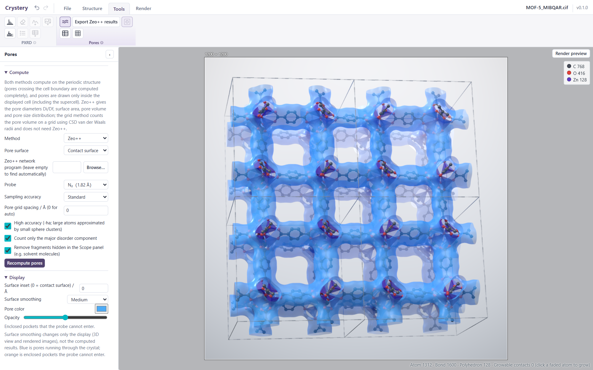

<sub>The Crystery window: the pores of MOF-5 computed with Zeo++ (the pore settings on the left) and a Mitsuba render preview in the render frame.</sub>

> ⭐ **If Crystery is useful to you, please star this repository, and if you use it for figures or calculations in a paper, please cite it in the Supporting Information (see [Supporting Crystery](#supporting-crystery)).** It is the best way to support its development.

[Download](#download) · [Getting started](#getting-started) · [Manual](docs/manual.en.md) · [Gallery](#gallery) · [Features](#features) · [FAQ](#faq) · [Supporting Crystery](#supporting-crystery) · [License](#license) · [Feedback](#feedback)

## Download

Get the latest version from the [Releases](https://github.com/luylin5/Crystery-release/releases) page:

| File | What it is |
|---|---|
| `Crystery-<version>-setup.exe` | **Installer (recommended)**: choose where to install; desktop and Start-menu shortcuts |
| `Crystery-<version>-portable.exe` | Portable app: nothing to install, double-click to run |

- Requirements: Windows 10 / 11, 64-bit. Mitsuba renders faster with an NVIDIA GPU, and falls back to the CPU without one.
- The installed app keeps its settings in your AppData and its gallery in Documents\Crystery 图库, so updating or uninstalling keeps them; the portable app keeps them in a `Crystery-data` folder next to the program, so the whole folder can be moved as it is.
- Windows may warn about an unrecognised app (the installer is not code-signed): click "More info" › "Run anyway".
- **File › Help › Check for updates** in the app tells you when a new version is out.

## Getting started

1. **Open a structure**: drag the file into the window, or **File › Open** (Ctrl+O). You can also choose Crystery under "Open with" in File Explorer.
2. **Shape the view**: right-drag to turn, scroll to zoom, middle-drag or Ctrl+right-drag to pan; click an atom to select it, double-click to select its whole molecule. Models, colours, polyhedra, supercells and so on are on the **Structure** ribbon, with their settings in the left panel.
3. **Render**: on the **Render** ribbon, choose the renderer (PyMOL or Mitsuba), set the image size and DPI, check the result with **Render preview**, then **Export image**. The frame in the middle of the view is exactly what gets exported.
4. **Save**: **Save to gallery** (Ctrl+S) keeps the structure, its settings and the view; click its thumbnail in the gallery (Ctrl+G) to open it again as it was. Save a look you like as a **style preset** and apply it to other structures.

### Demo: pores and rendering of MOF-5


Open MOF-5 → coordination polyhedra and a 2×2×1 supercell → **Tools › Pores** computes the pores with Zeo++ (N₂ probe) → the results table → **Render › Mitsuba** render preview. The waits for the calculation and the rendering are sped up. [Download the HD MP4](examples/demo/mof-5-demo.mp4)

The interface starts in English; switch to Chinese in **File › Options › Language**. Every feature is described in the **[manual](docs/manual.en.md)** (the same manual opens in the app with F1).

## Gallery

All pictures were made in Crystery; the pores were computed with the bundled Zeo++ and drawn into the renderings. The pictures are shown in the [Chinese section above](#示例图库):

- **MOF-5**: the pore contact surface for an N₂ probe, with ZnO₄ polyhedra (Mitsuba).
- **HKUST-1**: the connected channels (blue) and the pockets N₂ cannot reach (orange) (PyMOL).
- **Co-MOF-74**: 1D hexagonal channels seen along c, glowing on a dark background (Mitsuba).
- **P₄ in an Fe₄L₆ cage**: white phosphorus held in a tetrahedral cage, drawn as sticks with FeN₆ polyhedra and the guest space-filling (Mitsuba).
- **Rendering styles**: the same cage from the same angle — PyMOL ball-and-stick, sticks with outlines and space-filling; Mitsuba glossy plastic, metal, glass, glow, and matte with outlines and depth of field.

The structures are from the Cambridge Structural Database (CSD): MOF-5 (MIBQAR, [10.1021/jp103212z](https://doi.org/10.1021/jp103212z)), HKUST-1 (DOTSOV, [10.1002/anie.200803925](https://doi.org/10.1002/anie.200803925)), Co-MOF-74 (SATNOR01, [10.1002/anie.200501508](https://doi.org/10.1002/anie.200501508)) and P₄@Fe₄L₆ (COSZOA, [10.1126/science.1175313](https://doi.org/10.1126/science.1175313)). Their CIFs can be downloaded free of charge from the [CCDC](https://www.ccdc.cam.ac.uk/structures/) by refcode.

## Features

- **Open structures**: CIF, SHELX RES/INS, MOL/SDF, MOL2, PDB, XYZ / extended XYZ, VASP POSCAR, XSF, Gaussian input, CSSR; files holding several structures (data blocks, frames) can be stepped through.
- **Shape the view**: ball-and-stick, stick, space-filling, wireframe and thermal-ellipsoid models; element colours and radii, bonds and hydrogen bonds, weak interactions, coordination polyhedra, ring fill; supercells, growth, disorder; views along cell axes or any [uvw] / (hkl), perspective or orthographic projection, clipping planes; selection, measurement and labels.
- **Render pictures**: two renderers — **PyMOL** (ray tracing: fast, matches the view) and **Mitsuba 3** (path tracing: soft shadows, reflections, glass, glow, depth of field); image size, DPI and transparent background; frame-by-frame **videos** of turning and rocking structures.
- **PXRD simulation**: the powder pattern from the cell (wavelength, 2θ range, peak width, temperature factors, preferred orientation), with measured patterns (XRDML, RAS, two-column data) overlaid for comparison.
- **Pore analysis**: pore sizes, surface area, pore volume and pore size distribution with Zeo++ or a grid method, telling connected channels from closed pockets, with the pores drawn in the structure.
- **Gallery and styles**: save drawings with their settings to a gallery; save a look as a style and apply it to other structures with one click; batch-process many files.
- **AI assistants (MCP)**: once allowed in Preferences (off by default, this computer only), an AI assistant that speaks MCP can open structures, change the view, and render and export pictures in the window you are watching.
- **Chinese / English interface**, a built-in [manual](docs/manual.en.md) (F1) and a getting-started tour on first launch.

## FAQ

**Mitsuba is slow.** It uses an NVIDIA GPU when it can; when it cannot, the notice says why (most often an old graphics driver). Use the Preview quality while adjusting, and Fine for the final picture.

**How big is the exported image?** Exactly the width × height in pixels set in the render settings; the DPI is written into the image file for layout programs to work out the printed size. Journals usually ask for 300–600 DPI.

**Do I need to install Zeo++ for pores?** No, the installer and the portable app both include it. Molecules (files without a unit cell) have no pores or PXRD.

**A file does not open, or looks wrong.** Please attach the file and a screenshot in [Issues](https://github.com/luylin5/Crystery-release/issues).

## Supporting Crystery

Crystery is free. If it helped you, please support it in either of these ways:

1. **Star this repository** ⭐ with the Star button at the top right of this page. More stars help more people find Crystery.
2. **Cite it in the SI**: if you made figures or calculations with Crystery for a paper, please add a line to the methods in the Supporting Information, for example:

   > Crystal structure figures were prepared with Crystery 0.1.0 (https://github.com/luylin5/Crystery-release).

   As a reference:

   ```
   luylin5. Crystery (version 0.1.0) [Computer software]. 2026. https://github.com/luylin5/Crystery-release
   ```

   ```bibtex
   @software{crystery,
     author  = {luylin5},
     title   = {Crystery},
     version = {0.1.0},
     year    = {2026},
     url     = {https://github.com/luylin5/Crystery-release}
   }
   ```

When you use Crystery's pore analysis, please also cite Zeo++; for Mitsuba renderings you may also credit Mitsuba 3.

## License

Crystery is **free to use**, including for academic and commercial work, and the official release files may be shared unchanged; it may not be modified, decompiled and redistributed, or sold. Pictures and data you make with Crystery are yours. See [LICENSE](LICENSE).

The open-source components bundled with Crystery (PyMOL, Mitsuba 3, Zeo++, gemmi, NumPy, Electron and others) are distributed under their own licenses; see [THIRD_PARTY_NOTICES.md](THIRD_PARTY_NOTICES.md).

## Feedback

Please report problems and suggestions in [Issues](https://github.com/luylin5/Crystery-release/issues); attaching the structure file and a screenshot makes problems much easier to track down.
